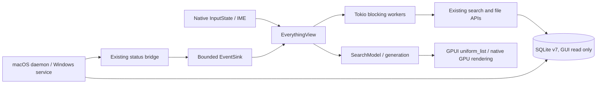

# GPUI native architecture

The GPUI migration replaces the entire window/UI lifecycle. The Rust crate
stays at `src-tauri/` to retain build paths; it no longer depends on Tauri,
WebKit/WebView2, a JavaScript bridge or bundled web assets.

`ui/mod.rs` opens a native window with the baseline custom titlebar, initializes gpui-component and
subscribes to its text input events. Queries retain the baseline 200ms leading and trailing scheduling, including a trailing total-count request. A monotonically increasing generation guards
fresh searches, sorting and index-triggered refreshes. Older responses cannot
replace rows or change selection/busy flags. Empty input invalidates old work and fetches the first page of all indexed entries, matching Tauri.

Initial pages contain 500 entries, or 100 for one character. Virtual rows are
27 logical pixels high. Near the loaded boundary, another page is fetched using
the fetched DB offset, independently of rows hidden by pending Trash operations.
A refresh fetches all previously loaded pages in engine-sized chunks and restores
selection by path. `uniform_list` retains the viewport. Server-side Name, Path,
Size and Modified sorts reset the viewport and invalidate pending responses.

File actions call the shared Rust APIs on worker threads. The existing read-only
GUI rule remains: rename/trash change the filesystem; the daemon/service updates
the index. Pending-trash tombstones hide a removed subtree while that update is
in flight. A failed rename retains its input. Trash reports successes and
individual failures. Dialog keyboard handling traps normal shortcuts, defaults
to Cancel and supports Tab/arrows, Enter/Space and Escape. The macOS menu uses the same muda/AppKit implementation and separators as Tauri; Windows uses the existing Explorer Shell menu directly.

The text input and rename editor use gpui-component InputState for selection,
clipboard and IME integration. Table shortcuts apply when the table has focus.
Enter opens files on both platforms. Following merged commit `86f525b`, macOS starts rename after another single click on the selected item and the system double-click interval plus 50ms; F2 remains Windows-only. Pending renames cancel on pointer presses, keys, scrolling, dragging, search focus or window deactivation. macOS Cmd+C copies files and Alt+Cmd+C copies paths; Windows Ctrl+C copies paths. Native outgoing drag
uses the drag crate. macOS Cmd+Shift+Space uses global-hotkey.

Index/status events pass through `runtime::EventSink`: a bounded wake channel
and the latest payload per event type bound queue growth. Native render state is
updated on the GPUI executor. Database/filesystem/shell work uses Tokio blocking
workers; status refresh and icon loading never wait on the foreground executor.
When inactive, `ui_gate` coalesces index events until activation. The WebKit
repaint watchdog is removed.

`ui/status.rs` preserves configuration-change notices until each is dismissed,
and tracks indexing progress, elapsed/completion time and catchup display rules.
The status dot pulses only while indexing or background work is active. The
auto-start label and action both use the actual registration and opt-out state.

The UI follows system appearance and embeds the baseline Inter/JetBrains Mono fonts and SVGs. Layout, colors, 30px titlebar, 34px search field, 27px rows and 33px statusbar come from the preserved CSS. No theme button or empty-table message is added.

Preferences (columns, content-window bounds, dismissed FDA banner) use
an atomically replaced per-user `gpui-preferences.json`. Windows preferences are
in roaming AppData, separate from the service-owned ProgramData index. macOS
onboarding/auto-start decisions continue to use the existing preferences domain.

Native `.app` packaging preserves `com.everything.app`, the lower-case
`Contents/MacOS/everything` executable and the embedded login-item LaunchAgent.
The plist BundleProgram resolves to the same executable. Developer ID signing
and optional notarytool profile support remain available; obsolete JIT/unsigned
executable-memory/library-validation entitlements are removed. Windows NSIS
retains the existing service/ACL/migration hooks and uses only path-scoped process
termination. No WebView2 bootstrap is needed. CI builds native artifacts.

Opt-in macOS `ui-automation` compiles a test driver that accepts only an explicit
Unix socket (0600). It injects key/mouse NSEvents and committed text through
NSTextInputClient, then captures that app's window. It does not mutate UI state. `EVERYTHING_UI_TEST` additionally
requires an isolated data directory; it never starts a daemon or writes actual
onboarding/auto-start settings. Optional UI state/paint metrics are test evidence,
not a production dependency. Performance runs disable state-file writes.

The retained engine/DB details are in `architecture.md` and `architecture_KR.md`.
The GPUI plan, test report and performance report record decisions, evidence and
platform verification limits.
